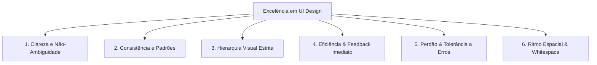

# Canonical UI Design Fundamentals, Design Systems & Visual Principles 🎨🖥️
# Fundamentos Canônicos de UI Design, Design Systems & Princípios Visuais 🎨🖥️

> **Global Sources & Authoritative References Ingested:**  
> - **Interaction Design Foundation (IxDF):** *UI Design Definition, Mental Models, UI Elements & History of Interfaces*.  
> - **Figma Resource Library & Figma Community:** *What is UI Design? UI Design Principles, UI Kits & Component Atoms*.  
> - **RD Station, Alura & EBAC Online:** *UI Design Fundamentals, Visual Architecture, Consistency and Conversion*.  
> - **UX Design Institute & Letraset Medium:** *The Anatomy of Interface Design: Visual Language, Typographic Hierarchy & Spacing Rhythm*.  
> - **Gabriel Silvestri (2025):** *What is UI Design and the Role of the Modern UI Designer*.  
> - **Salesforce UX/UI & Cronapp:** *Customer-Centric Enterprise UI and Scalable Design Systems*.  
> - **IADE Creative University & Academy of Art University:** *Academic Foundations of Visual Composition in Interactive Media*.

---

## 🇺🇸 English

### 🏛️ 1. What is UI Design (User Interface Design)?
While **UX (User Experience)** architecturally designs user journeys, pain points, information architecture, and mental workflows (*how it works*), **UI (User Interface)** is the direct visual, tactile, and sensory touchpoint between human and software (*how it looks, feels, behaves, and communicates meaning*).

UI Design encompasses:
1. **Visual Language:** Typography, color palettes, surfaces, elevation shadows, borders, and iconography.
2. **Interaction Design (IxD):** Control states (`default`, `hover`, `active`, `focus-visible`, `disabled`), screen transitions, and micro-feedbacks.
3. **Visual Ergonomics:** Vertical rhythm, modular typographic scale, readability, and pixel-perfect adherence to responsive grids.

---

### 💎 2. The 6 Canonical Principles of UI Design (Figma & IxDF)

1. **Clarity:**
   - Controls must never require effort to distinguish between buttons, text, and imagery.
   - **In Bootstrap:** Ensure clear visual affordance (`.btn-primary` with sharp contrast against surface).
2. **Consistency & Jakob's Law:**
   - Universal border-radius, shadows, and interactive cues across all views.
   - **In Bootstrap:** Leverage Sass/CSS tokens (`--bs-border-radius`, `--bs-box-shadow-sm`) over arbitrary inline values.
3. **Visual Hierarchy:**
   - Eye scanning follows **F** or **Z** reading patterns. Font size, weight, and color contrast steer attention from critical to secondary data.
   - **Modular Scale:** H1 (2.5rem), H2 (2.0rem), H3 (1.75rem), Body (1.0rem), Small (0.875rem).
4. **Immediate Feedback & System Status:**
   - All interactive components must acknowledge user input in $<100$ms (Doherty Threshold).
   - Mandatory control states: `default`, `hover`, `active`, `focus-visible`, `disabled`, and `loading` (spinner).
5. **Forgiving Design & Error Prevention:**
   - Protect users from destructive accidents (confirmation dialogs, undo actions, smart input masks).
6. **Whitespace & Spatial Breathing Room:**
   - Negative space groups concepts and eliminates cognitive fatigue.
   - **Base 4/8px Spacing:** Use Bootstrap utility scales `gap-1` (4px), `gap-2` (8px), `gap-3` (16px), `gap-4` (24px), `gap-5` (48px).

---

### 🧩 3. Atomic Component Hierarchy in Bootstrap
- **Atoms:** Color tokens (`#90271`), Typography (`Google Sans`), Icons (`Bootstrap Icons`), Spacers (4/8/16/24/48px).
- **Molecules:** Search inputs (`.input-group` + `.btn`), Badges with icons (`.badge.bg-success-subtle`), Breadcrumbs.
- **Organisms:** Navigation bar, collapsible sidebar (Mazer/AdminKit), data tables with pagination.

---

### 🎨 4. AI Agent Guidelines: Eliminating Visual "AI Slop"
1. **Never Nest Cards inside Cards:** Avoid `.card` inside `.card-body` unless strictly required by modular sub-widgets.
2. **Never Use Heavy Black Shadows:** Replace `box-shadow: 0 10px 30px rgba(0,0,0,0.5)` with refined `.shadow-sm` or `box-shadow: 0 1px 3px rgba(0,0,0,0.05)`.
3. **Subtle Borders by Default:** Always use Bootstrap 5.3+ `.border-subtle` for seamless light/dark adaptive rendering.
4. **Consistent Container Padding:** Stick to `.container-fluid` or `.container-xl` with unified horizontal gutters (`px-3 px-md-4`).
5. **Proper Line Heights:** Never apply `line-height: 1` on body paragraphs; enforce `.lh-base` (1.5) and `.lh-sm` (1.25) on headings.

---

## 🇧🇷 Português (Brasil)

## 🏛️ 1. O Que É UI Design (User Interface Design)?

Enquanto o **UX (User Experience)** arquiteta a jornada, mapeia as dores, organiza a arquitetura da informação e valida os fluxos cognitivos (o *"como funciona"*), o **UI (User Interface)** é o ponto de contato visual, tátil e perceptivo entre o ser humano e o software (o *"como se parece, como responde e como transmite significado"*).

O design de interface abrange:
1. **Linguagem Visual:** Tipografia, cores, superfícies, sombras, bordas e iconografia.
2. **Design de Interação (IxD):** Estados de botões (`hover`, `active`, `focus-visible`, `disabled`), transições de tela e micro-feedbacks.
3. **Ergonomia Visual:** Ritmo vertical, escala modular, legibilidade e alinhamento rígido a grids responsivos.

---

## 💎 2. Os 6 Princípios Canônicos do UI Design (Figma & IxDF)



### 1. Clareza (Clarity)
- Uma interface não deve exigir esforço para decodificar quem é botão, quem é texto e quem é imagem.
- **No Bootstrap:** Evite links sem sublinhado ou botões sem affordance visual clara (`.btn-primary` com bom contraste contra o fundo).

### 2. Consistência (Consistency & Jakob's Law)
- Mesmos botões, raios de borda (`border-radius`), sombras e convenções em todas as telas.
- **No Bootstrap:** Use tokens CSS (`--bs-border-radius`, `--bs-box-shadow-sm`) padronizados no Sass em vez de valores arbitrários (`style="border-radius: 7px"`).

### 3. Hierarquia Visual (Visual Hierarchy)
- O olho humano varre em **F** ou em **Z**. O tamanho, peso tipográfico e contraste de cor devem conduzir o olhar da informação mais crítica para a secundária.
- **Escala Modular:** H1 (2.5rem), H2 (2.0rem), H3 (1.75rem), Body (1.0rem), Small (0.875rem).

### 4. Feedback Imediato & Estado do Sistema
- Qualquer clique ou toque deve responder em menos de 100ms (Doherty Threshold).
- Estados obrigatórios de qualquer elemento clicável: `default`, `hover`, `active`, `focus-visible`, `disabled` e `loading` (spinner).

### 5. Tolerância a Erros (Forgiving Design)
- Impedir que o usuário cometa desastres acidentais (diálogos de confirmação, `undo` e campos com máscaras inteligentes).

### 6. Espaço em Branco (Whitespace & Breathing Room)
- Espaçamento não é vazio perdido; é o que separa conceitos e diminui o cansaço cognitivo.
- **Sistema de Espaçamento Base 4/8px:** No Bootstrap, use a escala de utilitários `gap-1` (4px), `gap-2` (8px), `gap-3` (16px), `gap-4` (24px) e `gap-5` (48px).

---

## 🧩 3. Anatomia Atômica de Componentes em Bootstrap (Design System Atoms)

Seguindo a metodologia de **Atomic Design** de Brad Frost e os kits de comunidade do **Figma**:

```text
┌────────────────────────────────────────────────────────┐
│  ÁTOMOS                                                │
│  - Cores (Primary, Subtle, Dark, Border)               │
│  - Tipografia (Google Sans Flex, Google Sans Code)     │
│  - Ícones (Bootstrap Icons, Game-Icons, RPG-Awesome)   │
│  - Espaçamentos (4px, 8px, 16px, 24px, 48px)          │
└───────────────────────────┬────────────────────────────┘
                            │
                            ▼
┌────────────────────────────────────────────────────────┐
│  MOLÉCULAS                                             │
│  - Campo de Busca (.input-group + .btn)                │
│  - Badges com ícone (.badge.bg-success-subtle)         │
│  - Breadcrumb (.breadcrumb + .breadcrumb-item)         │
└───────────────────────────┬────────────────────────────┘
                            │
                            ▼
┌────────────────────────────────────────────────────────┐
│  ORGANISMOS                                            │
│  - Navbar / Topbar corporativo                         │
│  - Sidebar sanfonada (Mazer/AdminKit pattern)          │
│  - Data Table com paginação e busca                    │
└────────────────────────────────────────────────────────┘
```

---

## 🎨 4. Diretrizes para Agentes de IA: Anti-Slop Visual em UI

Quando um agente de IA gera código Bootstrap, deve **evitar os 5 erros de "AI Slop" mais comuns**:
1. **Nunca crie Cards dentro de Cards:** Não aninhe `.card` dentro de `.card-body` a menos que seja um padrão estritamente justificado de dashboard analítico com sub-widgets.
2. **Nunca use Sombras Pesadas e Escuras:** Substitua `box-shadow: 0 10px 30px rgba(0,0,0,0.5)` pelo sutil e elegante `.shadow-sm` ou `box-shadow: 0 1px 3px rgba(0,0,0,0.05)`.
3. **Bordas Sutis por Padrão:** Use sempre a classe `.border-subtle` do Bootstrap 5.3+, que se adapta harmonicamente entre temas claro e escuro.
4. **Espaçamentos Consistentes em Containers:** Sempre use `.container-fluid` ou `.container-xl` com padding horizontal uniforme (`px-3 px-md-4`).
5. **Tipografia com Altura de Linha Adequada:** Nunca use `line-height: 1` em blocos de texto; adote `.lh-base` (1.5) ou `.lh-sm` (1.25) apenas em títulos curtos.
