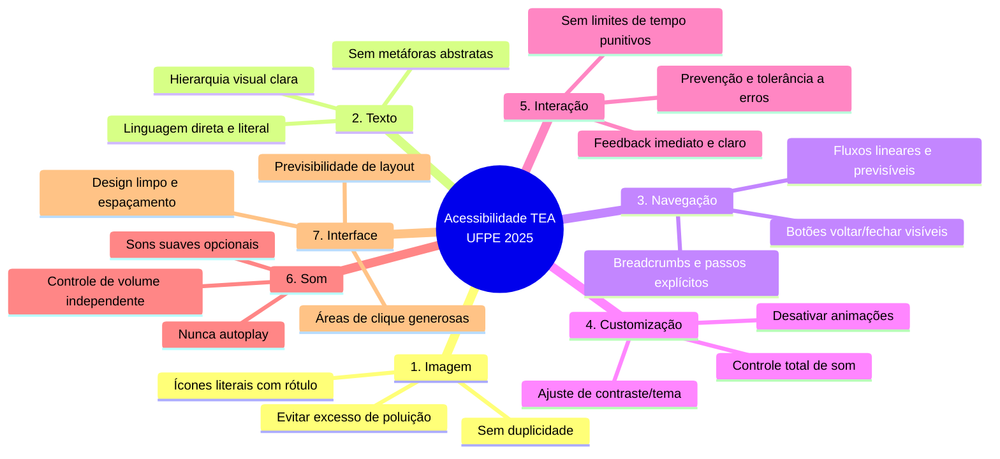

# Autism Spectrum (ASD) Accessibility & Sensory Ergonomics in UX/UI 🧠🧩
# Acessibilidade no Espectro Autista (TEA) & Ergonomia Sensorial em UX/UI 🧠🧩

> **Authoritative Sources & Theoretical Foundations:**  
> - Master's Thesis PPGDesign/UFPE (2025): *UX/UI Accessibility Guidelines for Evaluating Educational Apps for Autistic Children* — Lucas Rafael Belmiro Firmino Silva.  
> - Autistic UX Designer Field Reports (*Brasil UX Design* / *Ladies That UX BR*): *Communication Matters: Survival Tips from an Autistic UX Designer* & *UX for Neurodiversity*.  
> - *Interference Journal* (Acoustic Noise, Sensory Overload & Auditory-Visual Semiotics in Interactive Systems).  
> - Specialized Professional Communities (*r/UXDesign*).

---

## 🇺🇸 English

### 1. Overview: Autism Spectrum Disorder (ASD) & Sensory Processing
Autism Spectrum Disorder involves neurodevelopmental variations in social communication, flexible thinking, and **sensory processing**. Autistic individuals often experience **hypersensitivity** (acute or painful responses to bright lights, loud noises, high frequencies) and **hyposensitivity** (seeking specific sensory inputs).

In digital interfaces, unpredictable modal takeovers, aggressive animations, auto-playing sounds, and ambiguous metaphors induce cognitive exhaustion, sensory overload, and shutdowns.

---

### 2. The 7-Vector Accessibility Matrix (UFPE 2025)
1. **Image:** Literal icons paired with explicit text. Never rely on abstract metaphors alone.
2. **Text:** Concrete, literal language. Avoid sarcasm, idioms, or vague error messages.
3. **Navigation:** Linear, predictable paths with explicit breadcrumbs and step indicators.
4. **Customization:** Full user control over audio, animation reduction, and calming palettes.
5. **Interaction:** Immediate clear feedback, forgiving error tolerance, no punitive countdown timers.
6. **Sound:** Zero autoplay. Gentle frequencies (300Hz–800Hz) with independent volume toggles.
7. **Interface:** Clean layout, generous whitespace, large touch targets, predictable element positioning.

---

### 3. Bootstrap 5.3+ Technical Guidelines
- **Literal Controls:** Always pair icons with text (`<i class="bi bi-gear" aria-hidden="true"></i> <span>Settings</span>`).
- **Sensory Control Panel:** Provide switches to mute sound effects, disable animations, and activate soft palettes.
- **Microcopy:** Use straightforward error explanations ("Password must have at least 8 characters" instead of "Oops! Something is wrong").
- **Motion Reduction:** Fully respect `@media (prefers-reduced-motion: reduce)` on all components.

---

## 🇧🇷 Português (Brasil)

## 1. Visão Geral: O Espectro Autista e o Processamento Sensorial

O Transtorno do Espectro Autista (TEA) caracteriza-se por variações no neurodesenvolvimento que impactam a comunicação social, a cognição flexível e, fundamentalmente, o **processamento sensorial**. Pessoas autistas podem apresentar tanto **hipersensibilidade** (respostas acentuadas ou dolorosas a estímulos visuais, sonoros ou táteis) quanto **hipossensibilidade** (necessidade de estímulos intensos ou específicos para assimilação).

No contexto de interfaces digitais (web apps, sistemas e Foundry VTT), a falta de previsibilidade, o excesso de estímulos simultâneos, animações agressivas e linguagens figuradas/ambíguas geram fadiga cognitiva severa, sobrecarga sensorial (*sensory overload*) e crises de desregulação (*meltdowns* ou *shutdowns*).

---

## 2. A Matriz dos 7 Vetores de Acessibilidade TEA (UFPE 2025)

Com base nas pesquisas de Lucas Silva (UFPE, 2025), a avaliação e criação de interfaces inclusivas para pessoas autistas estrutura-se em **7 vetores fundamentais**:



---

## 3. Diretrizes Técnicas por Vetor & Implementação em Bootstrap 5.3+

### Vetor 1: Imagem & Iconografia
- **Problema:** Ícones puramente metafóricos (ex.: uma lâmpada para ideias ou engrenagens não contextualizadas) aumentam o custo cognitivo de decodificação.
- **Diretriz:** Todo ícone deve ser acompanhado de texto explicativo direto. Evite ilustrações puramente decorativas dentro da zona de tarefa principal.
- **Implementação Bootstrap:**
```html
<!-- INCORRETO: Ícone ambíguo sem texto -->
<button class="btn btn-outline-secondary"><i class="bi bi-gear"></i></button>

<!-- CORRETO: Ícone literal com rótulo textual e aria-hidden -->
<button class="btn btn-outline-primary d-inline-flex align-items-center gap-2">
  <i class="bi bi-gear-wide-connected" aria-hidden="true"></i>
  <span>Configurações do Sistema</span>
</button>
```

### Vetor 2: Texto & Linguagem Concreta
- **Problema:** Frases ambíguas, ironias, gírias ou mensagens de erro vagas geram insegurança e ansiedade no usuário autista.
- **Diretriz:** Empregue linguagem direta, literal e instrucional clara.
- **Exemplo de Microcópia:**
  - *Evitar:* "Ops! Algo deu muito errado no nosso quintal."
  - *Adotar:* "O e-mail digitado não contém o caractere '@'. Digite o e-mail completo."

### Vetor 3: Navegação & Previsibilidade
- **Problema:** Mudanças repentinas de layout, menus que saltam ou formulários em que o botão 'Avançar' muda de posição quebram o modelo mental.
- **Diretriz:** A navegação deve ser estritamente linear, consistente e com indicador explícito de etapas.
```html
<nav aria-label="Progresso da Ficha de Personagem">
  <ol class="breadcrumb bg-light p-3 rounded-3 border">
    <li class="breadcrumb-item"><i class="bi bi-check-circle-fill text-success me-1"></i> 1. Dados Básicos</li>
    <li class="breadcrumb-item active fw-bold text-primary" aria-current="step">2. Atributos & Habilidades</li>
    <li class="breadcrumb-item text-muted">3. Equipamento & Magias</li>
  </ol>
</nav>
```

### Vetor 4: Customização e Controle Sensorial
- **Problema:** Imposição forçada de temas de alto contraste, animações ou esquemas cromáticos agressivos.
- **Diretriz:** Oferecer botões explícitos e acessíveis de ajuste sensorial (reduzir animações, silenciar sons, paletas calmas).
```html
<!-- Painel de Conforto Sensorial -->
<div class="card border-primary-subtle shadow-sm my-3">
  <div class="card-header bg-primary-subtle text-primary-emphasis fw-bold d-flex align-items-center gap-2">
    <i class="bi bi-sliders"></i> Preferências Sensoriais & Cognitivas
  </div>
  <div class="card-body">
    <div class="form-check form-switch mb-3">
      <input class="form-check-input" type="checkbox" role="switch" id="toggleMuteAll">
      <label class="form-check-label" for="toggleMuteAll">Silenciar todos os efeitos sonoros da interface</label>
    </div>
    <div class="form-check form-switch mb-3">
      <input class="form-check-input" type="checkbox" role="switch" id="toggleReduceMotion">
      <label class="form-check-label" for="toggleReduceMotion">Desativar todas as animações e transições</label>
    </div>
    <div class="form-check form-switch">
      <input class="form-check-input" type="checkbox" role="switch" id="toggleCalmPalette">
      <label class="form-check-label" for="toggleCalmPalette">Ativar paleta de cores neutra e suave (baixa saturação)</label>
    </div>
  </div>
</div>
```

### Vetor 5: Interação & Prevenção de Ansiedade
- **Problema:** Timers regressivos estressantes (ex.: "Você tem 02:00 minutos para preencher") e modais destrutivos sem confirmação.
- **Diretriz:**
  1. Forneça sempre opção para pausar ou estender qualquer limite de tempo (WCAG 2.2 Critério 2.2.1).
  2. Forneça feedback visual imediato após ações (ex.: `toast` suave sem som invasivo).
  3. Toda ação destrutiva requer diálogo claro com botões que explicam exatamente a ação: "Sim, Excluir Registro" e "Cancelar".

### Vetor 6: Som & Ruído Acústico (*Interference Journal*)
- **Problema:** Efeitos sonoros agudos, notificações súbitas ou reprodução automática de áudio causam choque e desconforto físico imediato.
- **Regras de Ouro:**
  - **Zero Autoplay:** Nenhum som deve ser reproduzido sem clique intencional do usuário.
  - **Frequências Suaves:** Sons de confirmação devem operar em frequências médias (300Hz - 800Hz), com envelope suave (*attack* lento e sem estalos/transientes ásperos).
  - **Independência de Mídia:** Notificações nunca devem depender unicamente de som para transmitir status; use texto e ícone simultaneamente.

### Vetor 7: Interface & Densidade Visual
- **Problema:** Elementos apinhados, contraste excessivo tipo neon sobre preto puro, ou caixas de diálogo sobrepostas.
- **Diretriz:** Respeito absoluto ao espaço em branco (*negative space*), alinhamentos rígidos e bordas sutis.

---

## 4. O Designer Autista & a Dinâmica de Trabalho Inclusiva

Com base nas experiências e relatórios da comunidade de designers autistas (*Brasil UX Design* e *Reddit r/UXDesign*):

1. **Comunicação Assíncrona e Documentada:**
   - Evite briefings orais vagos ou reuniões sem pauta definida.
   - Forneça instruções em tópicos objetivos, com critérios de aceitação claros.
2. **Defesa da Previsibilidade:**
   - Ambientes com rotinas estáveis, processos de design system bem documentados (tokens de cores, grids, componentes) beneficiam tanto o profissional neurodivergente quanto o usuário final.
3. **Hiperfoco como Vantagem:**
   - A capacidade de atenção a detalhes, identificação de inconsistências em design systems e auditorias de acessibilidade WCAG tornam profissionais autistas referências naturais em QA e Design Ops.

---

## 5. Checklist Rápido de Verificação de Interface (Auditoria TEA)

- [ ] **Sem reprodução automática:** Áudios e vídeos iniciam apenas com clique explícito.
- [ ] **Redução de movimento respeitada:** `@media (prefers-reduced-motion: reduce)` está implementado em todos os componentes interativos.
- [ ] **Linguagem direta:** Títulos e botões explicam a ação exata ("Salvar alterações", não "Pronto!").
- [ ] **Contraste suave e sem vibração:** Textos principais com contraste $\ge 4.5:1$, evitando fundo `#000000` puro com texto `#00ff00` saturado.
- [ ] **Ícone + Texto sempre juntos:** Nenhum botão crítico depende unicamente de um ícone abstrato.
- [ ] **Previsibilidade espacial:** Botões principais mantêm a mesma posição em todas as telas e diálogos.

