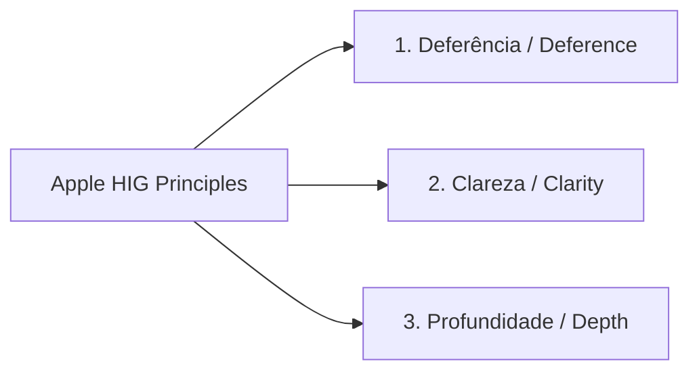

# Human Interface Guidelines (HIG) & Comparative Design Systems 🍏🪟🐧
# Human Interface Guidelines (HIG) & Design Systems Comparados 🍏🪟🐧

> **Official Platforms & Authoritative Sources Ingested:**  
> - **Apple Human Interface Guidelines (HIG):** *iOS, macOS, watchOS, visionOS & Apple Design System*.  
> - **Microsoft Fluent UI (v9 / Web):** *Elevation, Fluent Tokens, Light & Depth, Acrylic/Mica and Accessibility*.  
> - **GNOME Human Interface Guidelines:** *Simplicity, Task Focus, Keyboard-First and Clean Spacing*.  
> - **KDE Human Interface Guidelines:** *Action Consistency, Menu Ergonomics and Modular Flexibility*.  
> - **DesignSystems.surf & DesignSystems.one:** *Comparative anatomy of the world's leading design systems*.  
> - **Eonist & LogRocket:** *Design token engineering and translating HIG standards into Modern Web Components*.

---

## 🇺🇸 English

### 🏛️ 1. What is a Human Interface Guideline (HIG)?
A **Human Interface Guideline (HIG)** is a canonical set of software design conventions, cognitive ergonomics, layout grids, and accessibility benchmarks established by platform maintainers (Apple, Microsoft, GNOME, KDE). It ensures applications offer instinctive predictability, visual elegance, and effortless familiarity.

---

### 🍏 2. The Three Pillars of Apple HIG Applied to Bootstrap

1. **Deference (The Content is Sovereign):**
   - The UI must step back and let user content shine. Extravagant decorations, chaotic gradients, and oversized drop shadows that compete with information must be purged.
   - **In Bootstrap:** Pristine neutral canvas (`#F8F9FA` or `#FFFFFF`), cards with ultra-thin borders (`border border-subtle`), eliminating ornamental clutter.
2. **Clarity:**
   - Text must be legible at every viewport scale; symbols must have singular, literal meanings; negative space around buttons must prevent accidental clicks.
   - **In Bootstrap:** Minimum **44x44px** touch targets (Fitts + HIG), calibrated typography (`Google Sans` or `SF Pro`), and high-contrast text ($\ge 4.5:1$).
3. **Depth & Surfaces:**
   - Translucent layers, background blurs (*backdrop-filter / frosted glass*), and delicate elevation tiers establish intuitive window/modal hierarchies.
   - **In Bootstrap (Apple Frosted Glass Style):**
     ```css
     .apple-glass-topbar {
       background-color: rgba(255, 255, 255, 0.85) !important;
       backdrop-filter: blur(20px) saturate(180%);
       -webkit-backdrop-filter: blur(20px) saturate(180%);
       border-bottom: 1px solid rgba(0, 0, 0, 0.08);
     }
     ```

---

### 🪟 3. Comparative Overview: Apple HIG vs Microsoft Fluent vs GNOME / KDE

| Platform | Core Philosophy | Depth & Illumination | Spatial Geometry & Interaction | Bootstrap Implementation |
| :--- | :--- | :--- | :--- | :--- |
| **Apple HIG** | Deference, clarity, frosted glass, organic rounded corners (*squircle*). | `backdrop-filter: blur()`, diffuse soft ambient shadows. | 44px targets, organic radii (`border-radius: 12px` to `16px`). | `.rounded-4`, `.shadow-sm`, translucent blurs. |
| **Microsoft Fluent UI** | Directional lighting, depth (Mica/Acrylic), responsive motion. | 5-level elevation system (`elevation-1` to `5`), material depth. | Strict 4/8px base grids, high-contrast double focus rings. | Dual accessible focus rings (`.focus-ring`), crisp cards on pearl gray `#F3F3F3`. |
| **GNOME HIG** | Functional minimalism, no nested submenus, task-focused flow. | Flat borders, elimination of decorative drop shadows. | Generous buttons, unified header bars (*HeaderBar*). | Unify title and actions via `.d-flex.justify-content-between`. |
| **KDE HIG** | User empowerment, dense operational metrics, customizability. | High-contrast controls, Breeze palette, distinct dividing panels. | Deep keyboard accessibility, status footers, power shortcuts. | Explicit breadcrumbs, status bars, and `Ctrl+K` commands. |

---

### 🎛️ 4. AI Agent Golden Rules for Design Systems
1. **Corner Radius Harmony:** Never place a `border-radius: 4px` button inside a `border-radius: 24px` card. Follow harmonic nesting: inner radius $\approx$ outer radius - padding.
2. **Affordance & Interactive Transitions:** Every button must feature smooth feedback transitions (`transition: all 0.15s ease-in-out`).
3. **Bootstrap Elevation Scale:**
   - Level 0 (Surface): `border border-subtle`
   - Level 1 (Resting Card): `.shadow-sm`
   - Level 2 (Hover Card / Dropdown): `.shadow`
   - Level 3 (Modal / Offcanvas): `.shadow-lg`

---

## 🇧🇷 Português (Brasil)

## 🏛️ 1. O Que É uma HIG (Human Interface Guideline)?

Uma **Human Interface Guideline (HIG)** é o conjunto supremo de convenções de design, psicologia cognitiva, engenharia de layout e padrões de acessibilidade criado por mantenedores de plataformas (Apple, Microsoft, GNOME, KDE) para garantir que desenvolvedores construam aplicações com previsibilidade, elegância e familiaridade instintiva.

---

## 🍏 2. Os Três Pilares da Apple HIG Aplicados ao Bootstrap

A Apple estabelece 3 mandatos primordiais que todo designer e desenvolvedor deve perseguir:



### 1. Deferência (Deference / O Conteúdo é o Rei)
- A interface gráfica deve ser discreta e ceder o palco principal ao conteúdo do usuário. Ornamentos pesados, sombras gigantes ou gradientes berrantes que competem com o texto ou dados devem ser eliminados.
- **No Bootstrap:** Fundo claro neutro (`#F8F9FA` ou `#FFFFFF`), cards com bordas ultrafinas (`border border-subtle`), eliminando decorações excessivas.

### 2. Clareza (Clarity)
- O texto deve ser legível em qualquer escala; ícones devem ter significados diretos; o espaço ao redor dos botões deve permitir toques sem esbarrões.
- **No Bootstrap:** Alvos de clique de pelo menos **44x44px** (Fitts + HIG), tipografia calibrada (`Google Sans` ou `SF Pro`), e texto em alto contraste ($\ge 4.5:1$).

### 3. Profundidade & Superfícies (Depth)
- O uso de camadas visuais, desfoques translúcidos (*backdrop-filter / frosted glass*) e elevações suaves ajuda os usuários a entenderem a hierarquia de janelas e modais.
- **No Bootstrap (Efeito Frosted Glass Apple):**
```css
/* Efeito Vidro Fosco (Glassmorphism / Apple Style) em Topbars e Modais */
.apple-glass-topbar {
  background-color: rgba(255, 255, 255, 0.85) !important;
  backdrop-filter: blur(20px) saturate(180%);
  -webkit-backdrop-filter: blur(20px) saturate(180%);
  border-bottom: 1px solid rgba(0, 0, 0, 0.08);
}
```

---

## 🪟 3. Microsoft Fluent UI vs. Apple HIG vs. GNOME/KDE

| Plataforma | Conceito Central | Tratamento de Luz & Profundidade | Espaçamento & Ergonomia | Aplicação Prática no Bootstrap |
| :--- | :--- | :--- | :--- | :--- |
| **Apple (macOS / iOS HIG)** | Deferência, clareza, vidro fosco e cantos harmoniosos (*squircle*). | `backdrop-filter: blur()`, sombras difusas e camadas sutis. | Alvos de 44px, raios de borda orgânicos (`border-radius: 12px` a `16px`). | `.rounded-4`, `.shadow-sm`, topbars translúcidas com blur. |
| **Microsoft Fluent UI** | Luz direcionada, profundidade (Mica/Acrylic), movimento responsivo. | Elevações em 5 níveis (`elevation-1` a `5`), tokens de profundidade. | Grids estritos base 4px/8px, foco explícito com anel duplo. | Anéis de foco duplos (`.focus-ring`), cards brancos sobre fundo cinza-pérola `#F3F3F3`. |
| **GNOME HIG** | Minimalismo funcional, eliminação de menus aninhados, orientação por tarefa. | Bordas lisas, ausência quase total de sombras decorativas. | Botões generosos, cabeçalhos unificados (*HeaderBar*). | Unificar título de página com ações em `.d-flex.justify-content-between.align-items-center`. |
| **KDE HIG** | Poder para o usuário, densidade de dados equilibrada e configurabilidade. | Alto contraste de controle, paletas Breeze e divisão nítida de painéis. | Suporte excepcional a atalhos de teclado e barras de status úteis. | Breadcrumbs explícitos, barras de rodapé com status e atalhos rápidos (`Ctrl+K`). |

---

## 🎛️ 4. Regras de Ouro dos Design Systems para Agentes de IA

1. **Raio de Borda Consistente (Corner Radius Harmony):**
   - Nunca misture um botão com `border-radius: 4px` ao lado de um card com `border-radius: 24px`.
   - Mantenha a hierarquia: se o card tem `border-radius: 16px`, os botões internos devem ter `border-radius: 8px` ou `10px` (raio interno = raio externo - padding).
2. **Affordance e Estados dos Componentes:**
   - Todo botão interativo deve ter transição suave de cor (`transition: all 0.15s ease-in-out`).
   - Evite remover o outline de foco sem fornecer substituto acessível.
3. **Escala de Elevação e Sombras em Bootstrap:**
   - Nível 0 (Superfície): `border border-subtle`
   - Nível 1 (Card em repouso): `.shadow-sm`
   - Nível 2 (Card em hover / Dropdown): `.shadow`
   - Nível 3 (Modal / Offcanvas): `.shadow-lg`
