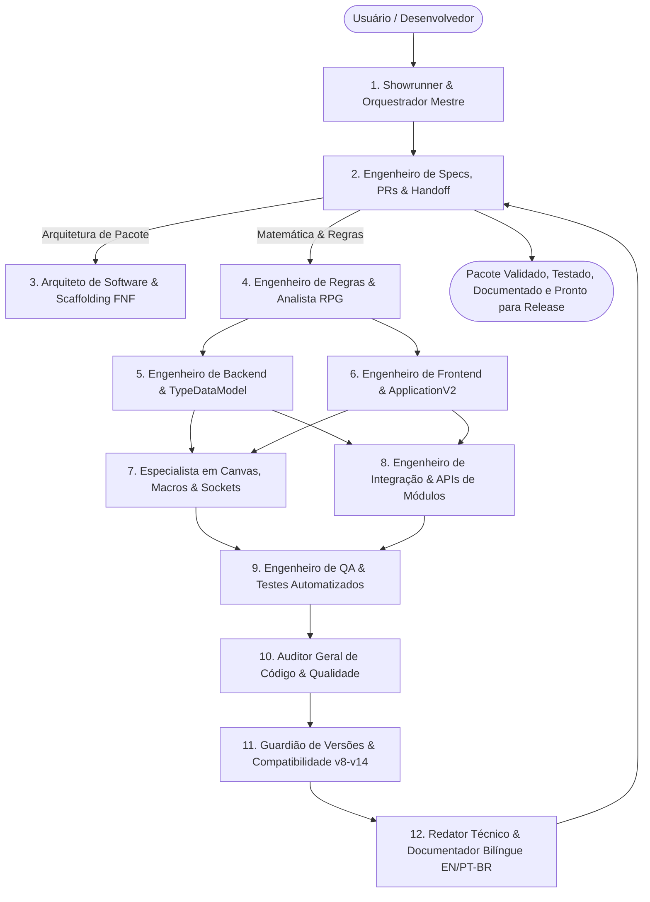

# Master of Foundry VTT 🎲⚡

> **Comprehensive Foundry Virtual Tabletop Mastery, Development & Architecture Suite**  
> *Suíte Completa de Desenvolvimento, Arquitetura e Mestria em Foundry Virtual Tabletop por GM Charles Corrêa*  
> **Current up to Foundry VTT v14.369 Stable**

---

## 🏛️ Topologia dos 12 Sub-agentes Especializados / 12-Subagent Architecture

Para erradicar alucinações de API entre versões do Foundry, evitar bugs silenciosos e garantir código limpo, testado e documentado, o desenvolvimento é executado por uma **linha de montagem de 12 agentes especializados com Quality Gates**:



| # | Especialista | Papel Principal | Entregáveis & Foco |
|---|---|---|---|
| **1** | **Showrunner & Orquestrador** | Triagem, entrevista inicial (`grill-me`) e roteamento | Exigência da versão-alvo do Foundry e sistema de RPG |
| **2** | **Specs, PRs & Handoff** | Gestão do ciclo de vida e engenharia de release | RFCs técnicas, Pull Requests padronizadas e guias de handoff |
| **3** | **Arquiteto & Scaffolding FNF** | Estruturação de projetos modernos | [Foundry Next Factory (FNF)](https://github.com/CharlesCorreaDev/fvtt-modules-plus/tree/main/foundry-next-factory) (`vite-ts-appv2` / `vanilla-esm`) |
| **4** | **Engenheiro de Regras / Analista RPG** | Decodificação matemática de sistemas de RPG | Modelos AnyDice, atributos, progressão e condições de combate |
| **5** | **Backend & TypeDataModel** | Modelagem de dados em classes puras sem HTML | `foundry.abstract.TypeDataModel`, campos estritos e migrações |
| **6** | **Frontend & UI (ApplicationV2)** | Interface visual reativa e moderna | `ApplicationV2`, `HandlebarsApplicationMixin` e CSS isolado |
| **7** | **Canvas, Macros & Sockets** | Interatividade visual e client-server RPC | PixiJS (`PrimaryCanvasGroup`), sockets seguros e Active Effects |
| **8** | **Integração & APIs de Módulos** | Interoperabilidade com o ecossistema | Midi-QOL, Sequencer, Item Piles, Token Action HUD e exportação de API |
| **9** | **QA & Testes Automatizados** | Confiabilidade em tempo de execução | Testes unitários com Vitest/Jest, validação de Hooks e fixtures |
| **10** | **Auditor Geral de Código** | **REVISÃO SUPREMA DE TODOS OS AGENTES** | SAST, caça a memory leaks, anti-slop e Quality Gate Approval |
| **11** | **Guardião de Versões & Compatibilidade** | Prevenção de quebra de contrato de API | Bloqueio de APIs obsoletas (v8 a v14+) e conformidade com políticas |
| **12** | **Redator Técnico Bilíngue** | **Documentação estrita em EN e PT-BR** | READMEs, manuais, guias rápidos, JSDoc e i18n (`languages/*.json`) |

Consulte os manuais detalhados em [`references/`](references/).

---

## 📖 Manual de Uso da Skill & Exemplos Práticos / Skill Usage Manual & Examples

A skill opera de forma reativa através de linguagem natural ou comandos especializados. Ela é bilíngue por padrão (respondendo e documentando em **Português Brasileiro e Inglês**).

### 1. Comandos Principais & Modos de Trabalho / Core Commands & Modes

| Comando / Flag | Especialista Acionado | O Que Faz / What it Does |
|---|---|---|
| `/releases` ou `--check-releases` | **Guardião de Versões** | Consulta o portal oficial de releases, traduz o changelog e compara com sua versão instalada. |
| `/novo-modulo` ou `/novo-sistema` | **Arquiteto & Scaffolding FNF** | Executa o Foundry Next Factory para criar projetos em `vite-ts-appv2` ou `vanilla-esm`. |
| `/datamodel` | **Backend Dev** | Gera classes `foundry.abstract.TypeDataModel` com validação de campos tipados. |
| `/sheet-v2` | **Frontend Dev** | Gera fichas reativas com `ApplicationV2`, `HandlebarsApplicationMixin` e CSS namespaced. |
| `/macro` ou `/socket` | **Canvas & Sockets Dev** | Gera macros assíncronas seguras, RPC cliente-servidor e integração com PixiJS. |
| `/integrar-api` | **Integração de APIs** | Configura integração defensiva com Midi-QOL, Sequencer, Item Piles ou exporta API própria. |
| `/testar` ou `/qa` | **QA & Testes Automatizados** | Gera suites de testes unitários com Vitest para modelos de dados e Hooks. |
| `/revisar-codigo` | **Auditor Geral de Código** | Executa SAST estático contra memory leaks (`Hooks.off`), anti-slop e emite parecer de aprovação. |
| `/spec` ou `/pr` | **Specs, PRs & Handoff** | Cria RFC técnica, Pull Request padronizada e guia de handoff sob **SemVer 2.0.0 PT-BR**. |
| `/documentar` | **Redator Técnico Bilíngue** | Gera documentação espelhada obrigatória em Inglês e Português (`README`, JSDoc, i18n). |

---

### 2. Exemplos Práticos Canônicos / Practical Examples

#### Exemplo 1: Verificação de Novas Releases do Foundry VTT (`/releases`)

**Entrada do Desenvolvedor:**
> `/releases Tenho o Foundry v14.369 instalado. Tem alguma atualização nova?`

**Ação & Resposta da Skill:**
> Executa `python scripts/check_releases.py --installed 14.369` e responde de forma bilíngue:
> 
> 🚨 **ATENÇÃO: Nova Release Oficial Disponível no Foundry VTT!**  
> **Versão Detectada:** Version 14 Stable (Release 14.370) — Lançada em 02/11/2026  
> **Link Oficial:** [foundryvtt.com/article/v14-release-14-370/](https://foundryvtt.com/article/v14-release-14-370/)  
> 
> **Resumo Traduzido (PT-BR):**
> 1. **Segurança Crítica:** Atualizações urgentes no Node.js upstream para mitigar vulnerabilidades remotas.
> 2. **Autonomia de Senhas:** Jogadores agora podem definir e alterar suas próprias senhas diretamente na janela de Configurações de Usuário.
> 3. **Ferramenta Grid Space:** Controle cirúrgico para incluir ou excluir quadrados/hexágonos individuais da grade em Scene Regions e Measured Templates.
> 
> **Comparativo:** Sua versão instalada é a `v14.369`. A versão oficial atual é a `v14.370`.  
> 👉 **Recomendação:** Faça backup da pasta `UserData` e atualize sua instância para aplicar os patches de segurança.

---

#### Exemplo 2: Criar um TypeDataModel v14 Seguro sem template.json (`/datamodel`)

**Entrada do Desenvolvedor:**
> `/datamodel Crie o modelo de dados de Personagem para um RPG de horror cósmico no Foundry v14.`

**Saída Canônica do Backend Dev:**
```javascript
/**
 * Character DataModel for Cosmic Horror System (Foundry v14+).
 * Modelo de Dados de Personagem para Sistema de Horror Cósmico (Foundry v14+).
 */
export class PersonagemDataModel extends foundry.abstract.TypeDataModel {
  static defineSchema() {
    const fields = foundry.data.fields;
    return {
      atributos: new fields.SchemaField({
        vigor: new fields.NumberField({ required: true, integer: true, min: 1, max: 20, initial: 10 }),
        intelecto: new fields.NumberField({ required: true, integer: true, min: 1, max: 20, initial: 10 })
      }),
      sanidade: new fields.SchemaField({
        valor: new fields.NumberField({ required: true, integer: true, min: 0, initial: 50 }),
        maximo: new fields.NumberField({ required: true, integer: true, min: 1, initial: 100 })
      }),
      traumas: new fields.ArrayField(new fields.StringField())
    };
  }

  prepareDerivedData() {
    // Cálculo seguro sem risco de NaN
    this.sanidade.maximo = Math.max(10, this.atributos.intelecto * 5);
    this.sanidade.valor = Math.min(this.sanidade.valor, this.sanidade.maximo);
  }
}
```

---

#### Exemplo 3: Auditoria Geral de Código e Caça a Memory Leaks (`/revisar-codigo`)

**Entrada do Desenvolvedor:**
> `/revisar-codigo Revise este trecho de código de um HUD customizado.`

**Parecer do Revisor Supremo (Auditor Geral de Código):**
> 🚨 **PARECER DE QUALIDADE: REJEITADO COM APONTAMENTOS**
> 
> 1. **Vazamento de Memória Detectado (`Hooks.on` sem `Hooks.off`):**  
>    O código registra `Hooks.on("controlToken", ...)` dentro do método `render()` da janela. Como o método `render()` é executado múltiplas vezes a cada atualização de estado, centenas de listeners duplicados são acumulados no garbage collector do navegador.  
>    *Correção:* Registre o hook uma única vez no `Hooks.once("ready")` ou limpe o listener no método `_onClose()`.
> 2. **Violação de CSS Namespacing:**  
>    A folha de estilo altera a classe global `.window-content`. Isso corrompe as fichas de todos os outros módulos instalados no mundo.  
>    *Correção:* Encapsule o CSS sob `.meu-hud-customizado .window-content`.

---

## 🇺🇸 English

### 📌 Overview & Practical Authority
**Master of Foundry VTT** is an end-to-end development, scripting, automation, and rule ingestion suite designed for developers, module creators, and Game Masters running **Foundry Virtual Tabletop**.

> [!IMPORTANT]
> **Source Material & Real-World Experience:**  
> All information, architectural patterns, and troubleshooting guides in this repository are rigorously based on **official Foundry VTT documentation, official release notes, policies, and API references**, combined directly with **first-hand, battle-tested practical experience in developing custom modules and systems for Foundry VTT (including the latest v14 architecture, ApplicationV2, and TypeDataModels)**.

This suite encapsulates official documentation, knowledge base articles, policies, API references from **Version 8 through Version 14 (v14.369 Stable)**, native Model Context Protocol (MCP) integrations, CI/CD package publication automation, modern web exploration tools for module repositories, and architecture guides for over 60 famous RPG systems.

---

### 🌐 Knowledge Sources, Guides & Development Standards

| Category | Reference / Guides | Description |
|---|---|---|
| **Release & Packaging Pipeline** | [`scripts/foundry_package_publisher.mjs`](scripts/foundry_package_publisher.mjs) & [`guides/publishing-packages.md`](guides/publishing-packages.md) | Quality gate, HTTP 200 icon checks, safe zip packaging & official Foundry API release |
| **Technical Wiki & Lifecycle** | [`guides/wiki-and-release-lifecycle.md`](guides/wiki-and-release-lifecycle.md) | Exhaustive Wiki generation, interactive release gate and versioning protocol |
| **CI/CD & Scaffolding Templates** | [`templates/github/`](templates/github/) & [`scripts/scaffold_package.py`](scripts/scaffold_package.py) | Production-ready `checks.yml`, `release.yml`, `dependabot.yml` and Issue Templates |
| **Model Context Protocol (MCP)** | [`mcp/README.md`](mcp/README.md) & [`mcp/INSTALLATION.md`](mcp/INSTALLATION.md) | Native unified MCP server (`master-of-foundryvtt-mcp`), live state and reverse engineering |
| **CLI Tools & Automation** | [`guides/cli-tools.md`](guides/cli-tools.md) | Official `@foundryvtt/foundryvtt-cli` and `fvtt-world-cli` compendium packing |
| **Clean Code & Humanization** | [`guides/humanization-and-clean-code.md`](guides/humanization-and-clean-code.md) | Zero-emoji default, anti-AI tells and bilingual JSDoc/TSDoc code comments |
| **Bootstrap Prefixed UI/UX** | [`guides/bootstrap-prefixed-ui.md`](guides/bootstrap-prefixed-ui.md) | Mandatory CSS class prefixing, official 9-tone cold blue palette and approved icons |
| **Sensory & Cognitive Accessibility (A11y)** | [`guides/sensory-and-cognitive-accessibility.md`](guides/sensory-and-cognitive-accessibility.md) | 7-Vector A11y (UFPE 2025), TEA/ADHD sensory comfort, sound overload avoidance & fonts |
| **AnyDice Mathematical Modeling** | [`guides/anydice-dice-mechanics.md`](guides/anydice-dice-mechanics.md) | Dice mechanics probability modeling and conversion to Foundry `Roll` engine |
| **Sockets & Client-Server RPC** | [`guides/sockets.md`](guides/sockets.md) | Native `game.socket` & `socketlib` communication |
| **Combat Tracker & Automation** | [`guides/combat.md`](guides/combat.md) | `Combat`, `Combatant`, and `CombatTracker` mechanics |
| **AI & LLM Integration** | [`guides/ai-and-llm-integration.md`](guides/ai-and-llm-integration.md) | Integrate AI, Phil's Assistant, and AI Actors workflows |
| **Development Skills Matrix** | [`guides/development-skills-matrix.md`](guides/development-skills-matrix.md) | 14 Engineering Domains & professional developer standards |
| **Reverse Engineering & Spec Discovery** | [`guides/reverse-engineering.md`](guides/reverse-engineering.md) | REA (`rea-agents`) byte-by-byte AST & Reversa framework ([sandeco.github.io/reversa/pt/](https://sandeco.github.io/reversa/pt/)) for SDD spec extraction |
| **Famous Systems Knowledge Base** | [`systems/README.md`](systems/README.md) | Architecture for 60+ systems (D&D 5e, PF2e, WoD, SWADE, Tormenta20, YZE, GURPS) |
| **Official Systems Directory** | [foundryvtt.com/packages/systems](https://foundryvtt.com/packages/systems?page=1) | Official paginated package catalog |
| **Official Modules Directory** | [foundryvtt.com/packages/modules](https://foundryvtt.com/packages/modules?page=1) | Official paginated module catalog |
| **Official Foundry VTT Store** | [foundryvtt.store](https://www.foundryvtt.store/search?q=Savage+Worlds) | Search commercial and official content packages |
| **Knowledge Base (Official & Guides)** | [`kb/`](kb/) & [foundryvtt.com/kb](https://foundryvtt.com/kb/) | Core operations, scenes, actors, compendiums and reverse engineering |
| **SSL, HTTPS & Let's Encrypt (v14+)** | [`kb/07-ssl-and-https.md`](kb/07-ssl-and-https.md) | Native SSL in v14.369 vs Reverse Proxy setups |
| **Policies & Governance** | [`policies/`](policies/) | Limited License, AI Content Policy, Branding and Privacy Guidelines |
| **API Version Guides (v8 to v14)** | [`versions/`](versions/) | Dedicated API migration guides from v8 through v14.369 Stable |

---

### 🔍 Repository Inspection, Diagramming & Analysis Web Tools
For studying third-party systems and modules directly in the browser, via automated ingestion, or through GitLab & GitHub diagramming:

#### 1. Cloud & Browser Ingestion Tools (GitHub)

| Tool | URL Template | Example (Foundry D&D 5e / SWADE Tools) |
|---|---|---|
| **Gitingest** | `https://gitingest.com/{{owner}}/{{repo}}` | `https://gitingest.com/foundryvtt/dnd5e` |
| **GitDiagram** | `https://gitdiagram.com/{{owner}}/{{repo}}` | `https://gitdiagram.com/foundryvtt/dnd5e` |
| **Repomix** | `https://repomix.com/?repo={{owner}}/{{repo}}` | `https://repomix.com/?repo=lipefl/swade-tools` |
| **Uithub** | `https://uithub.com/{{owner}}/{{repo}}?maxTokens=500000` | `https://uithub.com/lipefl/swade-tools?maxTokens=500000` |
| **DeepWiki** | `https://deepwiki.com/{{owner}}/{{repo}}` | `https://deepwiki.com/lipefl/swade-tools` |
| **Star History** | `https://www.star-history.com/?type=date&repos={{owner}}/{{repo}}` | `https://www.star-history.com/?type=date&repos=foundryvtt/dnd5e` |

#### 2. Native GitLab & Multi-Platform Diagrammer (`scripts/generate_repo_diagram.mjs`)
For systems hosted on **GitLab** (such as the official **Savage Worlds Adventure Edition** at [`gitlab.com/peginc/swade`](https://gitlab.com/peginc/swade)), this skill includes a dedicated architectural diagrammer engine. It queries the GitLab REST API (v4) with automatic fallback to shallow git clone, producing instant Mermaid.js diagrams, layer breakdowns, and Markdown reports:

```bash
# Generate architecture diagram for a GitLab repository (e.g. SWADE):
node master-of-foundryvtt/scripts/generate_repo_diagram.mjs https://gitlab.com/peginc/swade

# Save output to Markdown artifact or file:
node master-of-foundryvtt/scripts/generate_repo_diagram.mjs https://gitlab.com/peginc/swade --output swade-architecture.md
```

#### 3. GitLab Model Context Protocol (MCP) Server Integration
For deeper real-time workspace queries, file reading, pipeline checks, and issue management directly on GitLab instances via AI agents:
- **Official GitLab MCP Server Docs:** [https://docs.gitlab.com/user/model_context_protocol/mcp_server/](https://docs.gitlab.com/user/model_context_protocol/mcp_server/)
- **Configuration (JSON):**
  ```json
  {
    "mcpServers": {
      "gitlab": {
        "command": "npx",
        "args": ["-y", "@modelcontextprotocol/server-gitlab"],
        "env": {
          "GITLAB_PERSONAL_ACCESS_TOKEN": "<GLPAT_TOKEN>",
          "GITLAB_API_URL": "https://gitlab.com/api/v4"
        }
      }
    }
  }
  ```

---

### 🚀 How to Install & Use this Skill in Your Favorite AI Agent

#### ⚡ Fast Installation via `npx skills` (Skills.sh & Agent Skills Directory)
The fastest way to install this skill directly into your AI coding assistant (Antigravity, Claude Code, Cursor, Windsurf, etc.) is via the official **`skills`** CLI:

```bash
# Install directly from GitHub into your current project:
npx skills add CharlesCorreaDev/skills-ai --skill master-of-foundryvtt

# Or install it globally for your user across all projects:
npx skills add CharlesCorreaDev/skills-ai --skill master-of-foundryvtt -g
```

#### Option 1: Install from GitHub via Agent Customizations / Skills Root
Clone or copy the `master-of-foundryvtt` folder into your agent's global or workspace skills directory:

```bash
# 1. Clone this repository (or copy the master-of-foundryvtt directory)
git clone https://github.com/CharlesCorreaDev/skills-ai.git

# 2. Link or copy to your agent's skill folder:
# For Antigravity / Gemini CLI:
# Global: ~/.gemini/config/skills/master-of-foundryvtt (or %USERPROFILE%\.gemini\config\skills\master-of-foundryvtt on Windows)
# Workspace: .agents/skills/master-of-foundryvtt

# For Claude Code:
# Global: ~/.claude/skills/master-of-foundryvtt
# Workspace: .claude/skills/master-of-foundryvtt

# For Cursor / Windsurf:
# Place inside .cursor/rules/ or reference SKILL.md in project rules (.cursorrules / .windsurfrules)
```

#### Option 2: Direct Workspace Integration
Simply drop the `master-of-foundryvtt/` folder inside your Foundry VTT module or system project root:
```text
my-foundry-system/
├── src/
├── system.json
└── .agents/
    └── skills/
        └── master-of-foundryvtt/   <-- Entire skill folder here
```

#### 💬 How to Prompt Your AI Agent
Once loaded, the AI Agent automatically detects `SKILL.md`. You can invoke it naturally or explicitly:

- **Developing a New System (v14):**
  > *"Create a new Foundry VTT v14 system using ApplicationV2 and TypeDataModel for a d20-based modern horror game with full CI/CD templates."*
- **Migrating Modules from v11/v12 to v14:**
  > *"Analyze this module's sheet code and migrate it from legacy Application to ApplicationV2 following the Master of Foundry VTT v14 standards."*
- **Finalizing and Publishing a Package:**
  > *"The module features are completed and tested. Prepare the comprehensive WIKI.md, bump the version to v1.1.0, and guide me through the release process."*
- **Connecting via MCP:**
  > *"Inspect active actors and scenes in my live local Foundry VTT server using the native master-of-foundryvtt MCP server."*

---

## 🇧🇷 Português (Brasil)

### 📌 Visão Geral e Experiência Prática
O **Master of Foundry VTT** é uma suíte completa de desenvolvimento, automação, ingestão de regras, CI/CD e arquitetura desenvolvida para desenvolvedores de sistemas, criadores de módulos e Mestres de RPG que utilizam o **Foundry Virtual Tabletop**.

> [!IMPORTANT]
> **Base Oficial e Experiência Prática Real:**  
> Todas as informações, arquiteturas, padrões de código e diretrizes contidas neste repositório são rigorosamente fundamentadas na **documentação oficial do Foundry VTT, notas oficiais de lançamento, diretrizes/políticas e referências de API**, somadas diretamente à **experiência prática acumulada no desenvolvimento ativo de módulos e sistemas para o Foundry VTT v14** (incluindo o novo paradigma `ApplicationV2`, `TypeDataModel`, arquitetura de canvas e ESM nativo).

Ela consolida a base de conhecimento oficial, artigos, termos de licença, governança de release, integrações MCP e referências de API da **Versão 8 até a Versão 14 (v14.369 Stable)**, oferecendo suporte para:

- **Automação de Releases & Publicação Oficial** ([`scripts/foundry_package_publisher.mjs`](scripts/foundry_package_publisher.mjs)): Validação pré-voo, auditoria de código, verificação de ícones HTTP 200, empacotamento zip seguro e disparo direto na API oficial de release do Foundry VTT.
- **Protocolo de Wiki Técnica Minuciosa** ([`guides/wiki-and-release-lifecycle.md`](guides/wiki-and-release-lifecycle.md)): Geração obrigatória de documentação profunda para Mestres, Jogadores, referência de APIs, hooks e esquemas DataModel.
- **Templates de CI/CD, Dependabot & Issues** ([`templates/github/`](templates/github/)): Workflows prontos de validação contínua (`checks.yml`), publicação (`release.yml`), Dependabot e issue templates.
- **Servidor MCP Nativo Oficial** ([`mcp/README.md`](mcp/README.md)): Controle unificado de atores, itens, cenas, macros, playlists, compêndios e engenharia reversa estática/remota.
- **Engenharia Reversa & Descoberta de Especificações (SDD)** ([`guides/reverse-engineering.md`](guides/reverse-engineering.md)): Dissecação estrutural com REA (`rea-agents`) e framework Reversa de Sandeco ([sandeco.github.io/reversa/pt/](https://sandeco.github.io/reversa/pt/)) para transformar sistemas legados em contratos de desenvolvimento orientado a especificações.
- **Visualizador e Gerador de Diagramas GitLab / Git** ([`scripts/generate_repo_diagram.mjs`](scripts/generate_repo_diagram.mjs)): Mapeador arquitetural para repositórios do GitLab (como Savage Worlds - SWADE) e GitHub, gerando diagramas Mermaid.js e relatórios de camadas.
- **Design de Interface Responsiva com Bootstrap Prefixado** ([`guides/bootstrap-prefixed-ui.md`](guides/bootstrap-prefixed-ui.md)): Classes prefixadas obrigatórias, paleta de 9 tons frios e ícones RPG homologados.
- **Ergonomia Sensorial e Acessibilidade Cognitiva (TEA/TDAH)** ([`guides/sensory-and-cognitive-accessibility.md`](guides/sensory-and-cognitive-accessibility.md)): Acessibilidade com os 7 Vetores (UFPE 2025), mitigação de sobrecarga acústica, modo de conforto sensorial e fontes clinicamente testadas (`Atkinson Hyperlegible`, `Lexend`).
- **Modelagem Estatística com AnyDice** ([`guides/anydice-dice-mechanics.md`](guides/anydice-dice-mechanics.md)): Validação matemática de dados antes da conversão para fórmulas do Foundry.
- **Humanização & Código Limpo** ([`guides/humanization-and-clean-code.md`](guides/humanization-and-clean-code.md)): Protocolo zero emojis por padrão e comentários estritamente bilíngues (Português/Inglês).
- **Base Arquitetural de 60+ Sistemas de RPG** ([`systems/README.md`](systems/README.md)): SWADE, D&D 5e, PF2e, Tormenta20, Year Zero Engine, Storyteller/WoD, Call of Cthulhu e mais.

---

### 🚀 Como Instalar e Usar no seu Agente de IA Favorito

#### ⚡ Instalação Rápida via `npx skills` (Skills.sh & Diretório Agent Skills)
A maneira mais rápida de instalar esta skill diretamente no seu agente de IA (Antigravity, Claude Code, Cursor, Windsurf, etc.) é utilizando a CLI oficial do **`skills`**:

```bash
# Instalar diretamente no projeto atual:
npx skills add CharlesCorreaDev/skills-ai --skill master-of-foundryvtt

# Ou instalar globalmente para seu usuário (todos os projetos):
npx skills add CharlesCorreaDev/skills-ai --skill master-of-foundryvtt -g
```

#### Opção 1: Instalação via Diretório de Skills / Customizações
Clone o repositório ou copie a pasta `master-of-foundryvtt` para a pasta de skills do seu assistente:

```bash
# 1. Clone o repositório
git clone https://github.com/CharlesCorreaDev/skills-ai.git

# 2. Vincule ou copie a pasta master-of-foundryvtt para o diretório de skills:
# No Antigravity / Gemini CLI:
# Global: ~/.gemini/config/skills/master-of-foundryvtt (ou %USERPROFILE%\.gemini\config\skills\master-of-foundryvtt no Windows)
# Workspace local: .agents/skills/master-of-foundryvtt

# No Claude Code:
# Global: ~/.claude/skills/master-of-foundryvtt
# Workspace local: .claude/skills/master-of-foundryvtt

# No Cursor / Windsurf:
# Copie para .cursor/rules/ ou referencie o SKILL.md no seu .cursorrules ou .windsurfrules
```

#### Opção 2: Integração Direta no Repositório do seu Módulo ou Sistema
Você pode colocar a pasta `master-of-foundryvtt/` dentro da raiz do seu projeto de módulo ou sistema:
```text
meu-modulo-foundry/
├── src/
├── module.json
└── .agents/
    └── skills/
        └── master-of-foundryvtt/   <-- Pasta completa da skill aqui
```

#### 💬 Exemplos de Comandos e Prompts para o Agente
Com a skill ativa, seu agente reconhece automaticamente as diretrizes do `SKILL.md`. Experimente prompts como:

- **Desenvolvimento de Novo Sistema (v14):**
  > *"Crie a base de um novo sistema para Foundry VTT v14 utilizando ApplicationV2 e TypeDataModel para um RPG de fantasia heroica com templates de CI/CD inclusos."*
- **Finalização e Release de Módulo:**
  > *"Concluímos o desenvolvimento do módulo de combate tático. Gere a Wiki explicativa completa (WIKI.md), incremente a versão e execute o pipeline de publicação."*
- **Inspeção de Mundo em Tempo Real via MCP:**
  > *"Conecte ao meu servidor Foundry local usando o MCP nativo do master-of-foundryvtt e inspecione o status e atores ativos."*
- **Diagrama de Arquitetura de Repositório do GitLab (ex: SWADE):**
  > *"Gere o diagrama de arquitetura Mermaid e o relatório completo de camadas do repositório GitLab https://gitlab.com/peginc/swade."*
- **Modelagem de Dados e Probabilidades:**
  > *"Modele uma mecânica de dados explosivos no AnyDice e converta em um avaliador customizado de DiceTerm para o meu sistema."*

---

## 👨‍💻 Author / Autor

**GM Charles Corrêa**  
- 🌐 **Website:** [rpg.charlescorrea.com.br](https://rpg.charlescorrea.com.br)  
- 📧 **Email:** [charlescorreaweb@gmail.com](mailto:charlescorreaweb@gmail.com)  
- 📷 **Instagram:** [@mestrecharlescorrea](https://www.instagram.com/mestrecharlescorrea)  
- 🐙 **GitHub:** [CharlesCorreaDev](https://github.com/CharlesCorreaDev)  
- ⚡ **Skills de IA By Charles Corrêa Repo:** [https://github.com/CharlesCorreaDev/skills-ai](https://github.com/CharlesCorreaDev/skills-ai)
