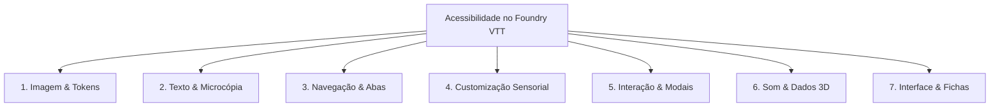

# Ergonomia Sensorial, Acessibilidade Cognitiva (TEA/TDAH) & A11y em Foundry VTT 🎲🧠

> **Compêndio de Acessibilidade & Ergonomia Sensorial para Módulos e Sistemas Foundry VTT:**
> - Dissertação de Mestrado PPGDesign/UFPE (2025): *Acessibilidade em UX/UI e Matriz dos 7 Vetores* — Lucas Silva.
> - Relatos de UX Designers Autistas (*Brasil UX Design*, *Ladies That UX BR*, *r/UXDesign*).
> - Estudos de Sobrecarga Acústica e Sensorial (*Interference Journal*).
> - Diretrizes de Design para TDAH (*Fast Company*, *Revista Projética/UEL*, *DIO.me*, *Homem Máquina*).
> - Padrões de Acessibilidade Visual e Daltonismo (WCAG 2.2 AA, LBI Lei 13.146/2015, ABNT NBR 17225).

---

## 1. O Desafio Sensorial e Cognitivo no Tabuleiro Virtual (VTT)

Sessões de RPG no Foundry VTT congregam simultaneamente:
- Mapas com luzes dinâmicas pulsantes e animações climáticas (névoa, chuva, fogo).
- Trilhas sonoras ambientes, efeitos de rolagem de dados e áudios de monstros.
- Fichas de personagem densas (centenas de números, perícias, magias e itens).
- Diálogos de chat que sobem rapidamente e janelas sobrepostas (*ApplicationV2*).

Para jogadores e mestres com **Transtorno do Espectro Autista (TEA)**, **TDAH**, dislexia ou baixa visão, essa sobrecarga sensorial e dispersão visual pode causar paralisia de escolha, esgotamento rápido e crises de sobrecarga (*sensory overload*).

---

## 2. A Matriz dos 7 Vetores Aplicada a Módulos e Fichas de Foundry

Baseada na metodologia da UFPE (2025), adaptada ao ecossistema Foundry VTT v11, v12, v13 e v14+:



### 1. Imagem & Iconografia de Ações
- **Problema:** Botões na ficha representados apenas por pequenos glifos (uma caveira minúscula ou espada sem texto) causam confusão e insegurança no jogador neurodivergente.
- **Regra:** Todo botão de rolagem deve possuir texto descritivo claro ou tooltip nativo rico (`data-tooltip="Rolar Ataque com Espada Longa: 1d20 + 5"`).
- **Ícones Literais:** Use ícones do `Game-Icons.net` ou `RPG-Awesome` com significados diretos.

### 2. Texto, Tipografia & Microcópia
- **Fontes Acessíveis em Fichas:** Ofereça opção de alternância para fontes com diferenciação clínica de caracteres: `Atkinson Hyperlegible` ou `Lexend`.
- **Prevenção de Ambiguidade:** Em diálogos de confirmação de dano, evite jargões ambíguos. Use microcópia direta: `"Aplicar 12 de dano de Fogo a [Nome do Alvo]"` em vez de `"Executar efeito?"`.

### 3. Navegação em Fichas Complexas (`ApplicationV2`)
- **Abas Persistentes:** Utilize navegação por abas verticais ou horizontais que mantêm o estado ativo (`activeTab`) mesmo após re-renderizações parciais da ficha.
- **Chunking (Miller 7±2):** Agrupe inventário em categorias colapsáveis (Consumíveis, Armas, Armaduras, Itens Mágicos) com contador de slots (`3/10 slots`).

### 4. Customização Sensorial (Painel de Aconchego Sensorial)
- Permita que o jogador ative facilmente no módulo ou sistema:
  - **Modo Suave / Calmo:** Reduz saturação das bordas neon de módulos cyberpunk ou horror.
  - **Desativar Foco Luminoso:** Desliga o tremor de luzes dinâmicas na visão do jogador se causar tontura/vertigem.
  - **Prevenção de Halation:** Fichas em modo escuro devem usar cinza ardósia (`#181b24` ou `#091633`), nunca preto puro (`#000000`) contra texto branco puro (`#ffffff`).

### 5. Interação & Tolerância a Falhas
- **Confirmação em Ações Destrutivas:** Gastar o último slot de magia nível 9 ou apagar um item lendário da ficha **DEVE** exigir confirmação explícita (`DialogV2.confirm`).
- **Sem Punição por Tempo:** Se o módulo implementar um timer de turno de combate, ofereça ao mestre a opção de pausar facilmente para dar tempo de leitura ao jogador neurodivergente.

### 6. Som & Dados 3D (*Interference Journal*)
- **Zero Som Surpresa:** Módulos de som ambiente nunca devem tocar estrondos agudos em volume 100% sem fade-in.
- **Frequências Suaves:** Sons de dados rolando devem usar frequências médias (300Hz a 800Hz), sem estalos agudos.
- **Opção de Mudo Rápido de Efeitos:** Atalho para silenciar rolagens de dados 3D sem desativar a voz dos amigos no Discord/WebRTC.

### 7. Interface Limpa & Previsibilidade Espacial
- **Preservação de Posição:** O botão de fechar a ficha (`close`) deve estar invariavelmente no canto superior direito de toda janela `ApplicationV2`.
- **Alvos de Clique Mínimos:** Todo botão de rolagem na ficha deve ter área mínima clicável de `36px` por `36px` (ideal `44px`) para evitar cliques errados durante o calor do combate.

---

## 3. Implementação Prática em SCSS e JS (`ApplicationV2`)

### Toggle de Modo Acessível no Sistema/Módulo:
```javascript
// client/settings.mjs
game.settings.register("meu-sistema", "sensoryComfortMode", {
  name: "Modo de Conforto Sensorial (TEA / TDAH)",
  hint: "Reduz animações bruscas na ficha, desativa tremores de tela e usa fontes de alta legibilidade.",
  scope: "client",
  config: true,
  type: Boolean,
  default: false,
  onChange: (value) => {
    document.body.classList.toggle("sensory-comfort-active", value);
  }
});
```

### Regras SCSS de Conforto Sensorial com Prefixo:
```scss
// assets/styles/accessibility.scss
body.sensory-comfort-active {
  // Substitui fontes ornamentadas por fonte legível
  --yze-font-sheet: "Atkinson Hyperlegible", "Google Sans", sans-serif;

  // Desativa animações e transições bruscas
  *, *::before, *::after {
    animation-duration: 0.01ms !important;
    animation-iteration-count: 1 !important;
    transition-duration: 0.01ms !important;
  }

  // Fundo calmante sem contraste cortante
  .yze-sheet {
    background-color: #141822 !important;
    color: #e2e8f0 !important;
    border-color: #3b5998 !important;

    // Alvos táteis e espaçamentos generosos
    .yze-btn-roll {
      min-height: 40px;
      padding: 6px 14px;
      font-weight: 600;
    }
  }
}
```

---

## 4. Checklist Rápido de Acessibilidade para Fichas e Módulos

- [ ] **Rótulo Textual:** Nenhum botão de ação ou rolagem depende unicamente de um ícone minúsculo sem tooltip explicativo.
- [ ] **Contraste Mínimo WCAG 2.2 AA:** Textos na ficha têm contraste $\ge 4.5:1$ contra o pergaminho ou fundo escuro.
- [ ] **Independência de Cor:** Status de dano, sangramento ou fadiga usa ícone + texto (ex: `🩸 Sangrando (-2 HP/turno)`), nunca apenas uma bolinha vermelha.
- [ ] **Zero Autoplay Hostil:** Sons de armadilhas ou magias respeitam o volume global e não disparam volumes extremos repentinos.
- [ ] **Controle do Usuário:** O jogador pode escolher fontes maiores ou ativar o Modo Conforto Sensorial.

