# Protocolo de Eficiencia de Tokens, SDD, TDD, Handoff & Rigor
## Token-Optimization Stack, Spec-Driven Development, TDD, Handoff & Rigor

Este guia estabelece o protocolo canonico e obrigatorio de ferramentas e skills companheiras para o ecossistema Skills AI, unindo a disciplina de engenharia de software ao stack supremo de economia de tokens (economia de 60% a 95% em contextos e saidas):

This guide establishes the canonical and mandatory companion skills and tooling protocol for the Skills AI ecosystem, combining software engineering discipline with the ultimate token-optimization stack (saving 60% to 95% in context windows and model outputs):

---

## Comandos Oficiais de Instalacao / Official Installation Commands

```bash
# 1. Stack Supremo de Economia de Tokens & Otimizacao de Contexto
npx skills@latest add headroomlabs-ai/headroom
npx skills@latest add rtk-ai/rtk
npx skills@latest add JuliusBrussee/caveman
npx skills@latest add dietrichgebert/ponytail

# 2. Engenharia Rigorosa, SDD, TDD & GodMode
npx skills@latest add noobygains/godmode
npx skills@latest add addyosmani/agent-skills --skill=spec-driven-development
npx skills@latest add mattpocock/skills --skill=grill-me
npx skills@latest add mattpocock/skills --skill=handoff
npx skills@latest add mattpocock/skills --skill=tdd

# 3. Qualidade, Governanca, Design & Auditoria de Seguranca
npx skills@latest add aihero-dev/skills-code-review
npx skills@latest add multica-ai/andrej-karpathy-skills
npx skills@latest add cloudflare/security-audit-skill
npx skills@latest add NVIDIA/auto-ontology
npx skills@latest add pbakaus/impeccable
```

---

## 1. O Stack Supremo de Economia de Tokens (Token-Optimization Stack)

### A. Headroom (headroomlabs-ai/headroom)
- Repositorio: https://github.com/headroomlabs-ai/headroom
- PT-BR: Proxy local e servidor MCP que comprime o contexto a montante (outputs de ferramentas, logs, JSONs e RAG) reduzindo de 60% a 95% os tokens antes de atingir o modelo, sem perda semantica.
- EN: In-process proxy and MCP server that compresses bloated downstream context (tool payloads, build logs, JSON structures, RAG chunks) achieving 60-95% token savings without losing semantic fidelity.

### B. RTK - Rust Token Killer (rtk-ai/rtk)
- Repositorio: https://github.com/rtk-ai/rtk
- PT-BR: Ferramenta CLI ultraveloz em Rust que atua como filtro de saida de terminal (PreToolUse hook), espremendo comandos verbosos (git status, suites de testes, compilacoes) para fracoes compactas antes da leitura pelo agente.
- EN: High-speed Rust CLI proxy that hooks into terminal outputs, squeezing verbose build streams and git outputs before the AI reads them.

### C. Caveman (JuliusBrussee/caveman)
- Repositorio: https://github.com/JuliusBrussee/caveman
- PT-BR: Modificador comportamental que forca respostas ultra-diretas, enxutas e sem preambulos (why use many token when few token do trick), preservando integridade tecnica e economizando ate 75% dos tokens de geracao.
- EN: Behavioral modifier enforcing concise, fluff-free communication (why use many token when few token do trick), slashing output tokens while preserving technical precision.

### D. Ponytail (dietrichgebert/ponytail)
- Repositorio: https://github.com/dietrichgebert/ponytail
- PT-BR: Filosofia do "dev senior mais preguicoso da sala" (anti-bloat, YAGNI supremo). O melhor codigo e o que nunca foi escrito. Forca o agente a resolver problemas com standard library nativa, dependencias existentes e minimalismo cirurgico sem abstracoes ou wrappers desnecessarios.
- EN: "Laziest senior developer in the room" philosophy (anti-bloat, ultimate YAGNI). The best code is the code you never wrote. Forces agents to solve problems using native standard libraries, existing project dependencies, and surgical minimalism without unnecessary abstractions or bloat.

---

## 2. Ciclo de Vida da Engenharia Rigorosa (SDD, TDD, Handoff & Grill-Me)

```mermaid
flowchart LR
    Idea([Demanda]) --> Caveman[Caveman / Headroom / RTK Token Optimization]
    Caveman --> GrillMe[Grill-Me Entrevista Alinhada]
    GrillMe --> SDD[SDD Addy Osmani PRD / Tech Spec]
    SDD --> Impeccable[Impeccable Design & Craftsmanship]
    Impeccable --> TDD[TDD Matt Pocock Red-Green-Refactor]
    TDD --> GodMode[GodMode NoobyGains Terminal Proof]
    GodMode --> Handoff[Handoff Compact Session State]
    Handoff --> Final([Memoria no Second Brain])
```



- **Spec-Driven Development (addyosmani/agent-skills):** Especificacao tecnica formal e criterios de aceitacao antes de escrever codigo.
- **Grill-Me (mattpocock/skills/grill-me):** Entrevista em rodadas estruturadas para eliminar ambiguidades de design.
- **Impeccable (pbakaus/impeccable):** Excelência em design de interface, craft visual, UX limpo, ergonomia cognitiva, acessibilidade e prevenção de visual slop / layouts genéricos de IA.
- **Handoff (mattpocock/skills/handoff):** Compacta o estado da sessao em artefatos limpos para permitir continuidade entre agentes sem estouro de contexto.
- **TDD (mattpocock/skills/tdd):** Impoe o ciclo estrito Red ➔ Green ➔ Refactor.
- **GodMode (noobygains/godmode):** Recusa de codigo frouxo e conclusao de tarefas sem testes aprovados e provados no terminal.

---

## 3. Impeccable (pbakaus/impeccable) — Design Craftsmanship & Anti-Slop

- **Repositorio:** https://github.com/pbakaus/impeccable
- **PT-BR:** Coleção de heurísticas e padrões de design frontend para agentes de IA criada por Paul Bakaus (ex-Google, criador do jQuery UI). Garante que qualquer código de interface (HTML, React, CSS, Bootstrap, Tailwind) atinja acabamento profissional impecável:
  - **Erradicação do Visual Slop de IA:** Proíbe paletas roxas/azuis genéricas sem identidade, cartões excessivamente flutuantes com sombras exageradas e espaçamentos caóticos.
  - **Hierarquia Tipográfica Impecável:** Linhas de texto com comprimento ideal de leitura (45 a 75 caracteres), contrastes em conformidade estrita com WCAG 2.2 AA/AAA e alinhamento visual rigoroso.
  - **Micro-interações e Estados de Feedback:** Todo componente interativo possui estados definidos para hover, active, focus-visible e disabled sem travamentos de layout.
  - **Sensibilidade de Contexto:** Adapta o design ao domínio do projeto (Dark/Grimdark para RPGs como Gravewright, Dashboard limpo para ferramentas de gestão, interfaces de alta densidade sem poluição).
- **EN:** Frontend design craftsmanship and anti-slop guidelines for AI agents by Paul Bakaus (creator of jQuery UI). Ensures web interfaces generated by agents feature impeccable polish, intentional typography, accessible contrast, thoughtful micro-interactions, and zero generic AI-generated visual bloat.

