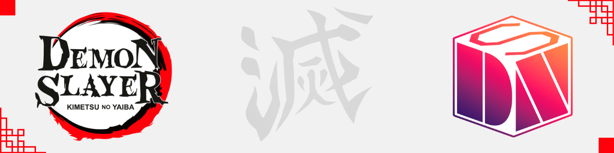
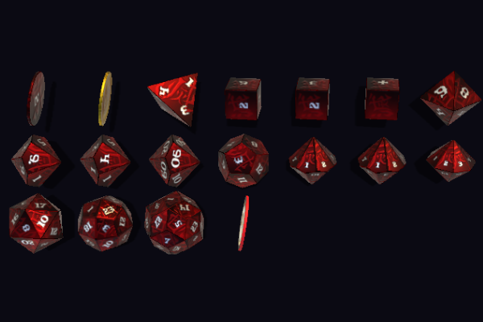
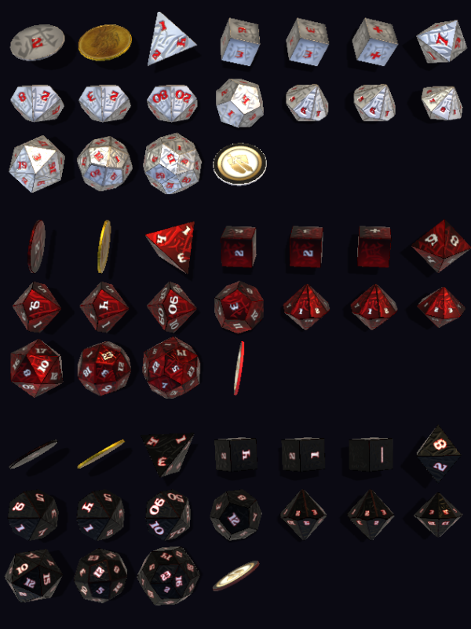

<div align="center">



# 🎲 Kimetsu no Yaiba Dice Theme for Dice So Nice!

[](https://foundryvtt.com)
[](https://foundryvtt.com/packages/dice-so-nice)
[](LICENSE)

[🇧🇷 Português](#-português-brasil) • [🇺🇸 English](#-english)

</div>

---

### 📸 Visualização dos Temas / Themes Preview

<div align="center">

#### 🎴 Demon Slayer Red (Chamas & Lâminas Nichirin)


#### ⚔️ Conjunto Completo de Temas (White, Red & Dark)


</div>

---

Tema visual de dados 3D feito por fãs e para fãs de **Kimetsu no Yaiba (Demon Slayer)**, integrando-se diretamente ao módulo [Dice So Nice!](https://foundryvtt.com/packages/dice-so-nice) no **Foundry Virtual Tabletop**.

Cinco variações visuais inspiradas na estética da Era Taishō, no Esquadrão de Exterminadores e nos Oni:
* 🎴 **White Theme (Respiração & Pureza):** Textura clara com números em rubro e contorno escuro.
* ⚔️ **Demon Slayer Red (Chamas & Lâminas Nichirin):** Vermelho vivo com números em alto contraste.
* 🌙 **Dark Theme (Noite dos Demônios):** Fundo escuro com contornos escarlates pulsantes.
* 🌊 **Dark Blue Theme (Respiração da Água):** Inspirado no Giyuu Tomioka, tons azuis profundos com numerais ciano brilhantes.
* 🍃 **Dark Green Theme (Haori do Caçador):** Inspirado no xadrez de Tanjiro Kamado, verde esmeralda com numerais luminosos.

---

## 🇧🇷 Português (Brasil)

### 📖 Sobre o Módulo
Desenvolvido em homenagem à obra de **Koyoharu Gotouge**, este tema traz a identidade visual de Demon Slayer para dentro das rolagens 3D no Foundry VTT. O foco foi garantir que cada rolagem na mesa tenha impacto visual sem perder a legibilidade durante o combate.

> ⚠️ **Requisito:** É necessário ter o módulo **Dice So Nice!** instalado e ativo no seu Foundry VTT.

* Projeto criado por fã, sem qualquer fim lucrativo. Feito para enriquecer a experiência das mesas de RPG.

---

### 🧩 Como Instalar no Foundry VTT

1. No menu principal do Foundry VTT, acesse a aba **Módulos Adicionais (Add-on Modules)**.
2. Clique em **Instalar Módulo**.
3. No campo **URL do Manifesto**, cole:
   ```text
   https://raw.githubusercontent.com/CharlesCorreaDev/fvtt-modules-plus/main/foundry-v14/modules/kimetsu-no-yaiba-dice-so-nice-foundry/module.json
   ```
4. Clique em **Instalar**.
5. No seu mundo, abra as opções do módulo:
   * Acesse: `Configurações do Jogo → Dice So Nice → Aparência dos Dados`.
   * Na seleção de temas, escolha uma das opções de **Kimetsu no Yaiba**.

---

### 👨‍🎨 Autor & Comunidade

* **Design e Adaptação:** **Mestre Charles Corrêa**
  * 🌐 Site Oficial: [rpg.charlescorrea.com.br](https://rpg.charlescorrea.com.br)
  * 🐙 GitHub: [@CharlesCorreaDev](https://github.com/CharlesCorreaDev/)
  * 📸 Instagram: [@MestreCharlesCorrea](https://instagram.com/MestreCharlesCorrea)
  * 💬 Discord: `MestreCharlesCorrea`
  * 💬 WhatsApp / Comunidade: [(51) 99585-9269](https://wa.me/5551995859269)

**Obra original:** *Kimetsu no Yaiba (Demon Slayer)* © Koyoharu Gotouge / Shueisha / Ufotable.  
Este projeto não possui afiliação oficial com os detentores dos direitos autorais.

---

### ⚖️ Licença
Distribuído sob a [Licença MIT](LICENSE).

<br/>

---

## 🇺🇸 English

### 📖 About This Module
A fan-made dice theme inspired by the universe of **Kimetsu no Yaiba (Demon Slayer)**, created by **Koyoharu Gotouge**.  
This add-on provides custom 3D dice textures for [Dice So Nice!](https://foundryvtt.com/packages/dice-so-nice), bringing the spirit of the Demon Slayer Corps and the Taishō Era to your rolls.

> ⚠️ **Requirement:** Requires the **Dice So Nice!** module to be installed and active.

* Fan-made project with no commercial purpose, made to enhance tabletop sessions.

---

### 🧩 Installation

1. In Foundry VTT, go to the **Add-on Modules** tab.
2. Click **Install Module**.
3. Paste the Manifest URL in the field:
   ```text
   https://raw.githubusercontent.com/CharlesCorreaDev/fvtt-modules-plus/main/foundry-v14/modules/kimetsu-no-yaiba-dice-so-nice-foundry/module.json
   ```
4. Click **Install**.
5. Open your world and navigate to:
   * `Game Settings → Dice So Nice → Dice Appearance`.
   * Pick any of the **Kimetsu no Yaiba** themes.

---

### 👨‍🎨 Author & Credits

* **Design & Foundry VTT Integration:** **Mestre Charles Corrêa**
  * 🌐 Website: [rpg.charlescorrea.com.br](https://rpg.charlescorrea.com.br)
  * 🐙 GitHub: [@CharlesCorreaDev](https://github.com/CharlesCorreaDev/)
  * 📸 Instagram: [@MestreCharlesCorrea](https://instagram.com/MestreCharlesCorrea)

**Original Work:** *Kimetsu no Yaiba (Demon Slayer)* © Koyoharu Gotouge / Shueisha / Ufotable.  
Fan project with no affiliation with official copyright holders.

---

### ⚖️ Licença / License
Distribuído sob a [Licença MIT](LICENSE). / Released under the [MIT License](LICENSE).

