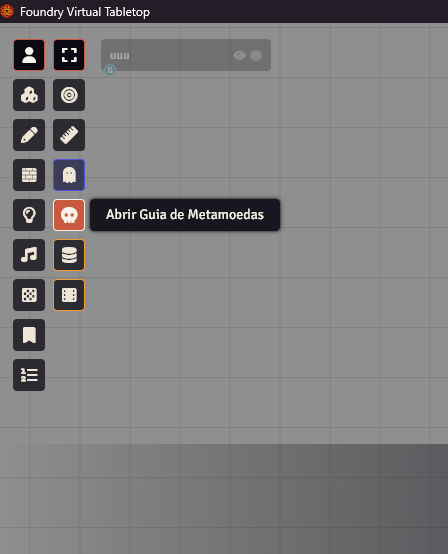
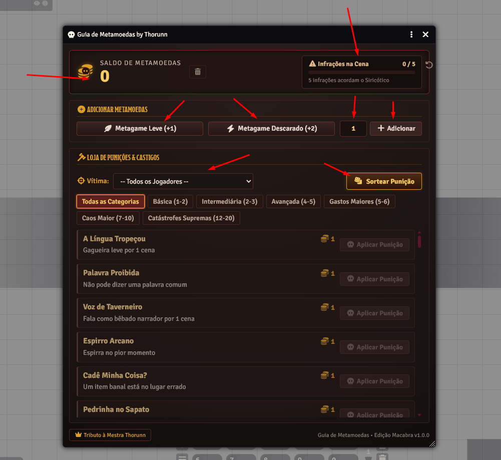
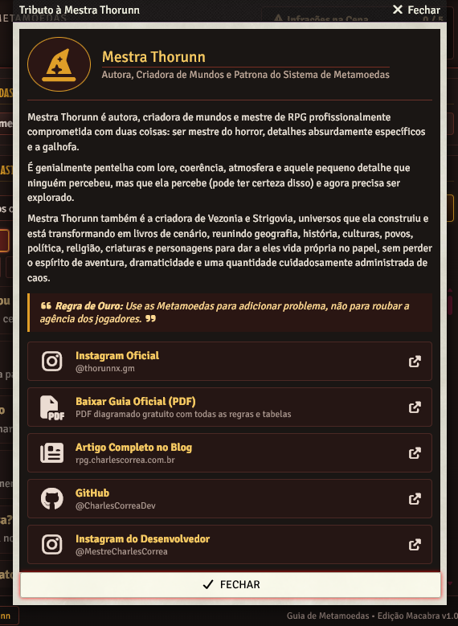
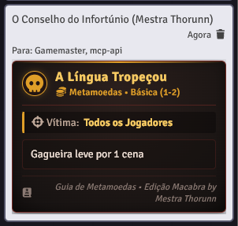

<div align="center">

# 💀 Guia de Metamoedas by Thorunn
### *Metacoins Guide by Thorunn for Foundry VTT*

**Turn your table's metagame into an economy of narrative chaos with the official rules and punishments from Mistress Thorunn.**  
*Transforme o metagame da sua mesa em uma economia do caos com as regras e punições oficiais da Mestra Thorunn.*

[](https://foundryvtt.com)
[](LICENSE)
[](https://foundryvtt.com)
[](https://www.instagram.com/thorunnx.gm/)
[](https://github.com/CharlesCorreaDev/)
[](https://instagram.com/MestreCharlesCorrea)
[](https://salinha.live/?c=6BMDF9#g=qrhshrw76y7m)
[](https://chat.whatsapp.com/FSr7xgejDqoHkfrrA5GxXj)

[🇧🇷 Português](#-português) • [🇺🇸 English](#-english)

---

</div>

<br/>

## 🇧🇷 Português

### 📖 Sobre o Módulo
O **Guia de Metamoedas by Thorunn** é um módulo para **Foundry Virtual Tabletop** 100% agnóstico a sistemas (D&D 5e, Savage Worlds, Tormenta20, Pathfinder 2e, Call of Cthulhu, etc.). Ele implementa digitalmente o sistema de economia do caos criado pela escritora e mestre profissional **Mestra Thorunn**.

Sempre que um jogador comete metagame, o Mestre ganha Metamoedas. Essas moedas são gastas em uma loja de infortúnios para adicionar complicações hilárias e memoráveis à narrativa.

> ⚖️ **A Regra de Ouro da Mestra Thorunn:**  
> *"Use as Metamoedas para adicionar problema, não para roubar a agência dos jogadores."*

---

### ✨ Principais Recursos

<table>
  <tr>
    <td width="50%">
      <h4>🪙 Economia do Caos em Tempo Real</h4>
      <ul>
        <li>Adicione moedas com 1 clique (<b>+1 Leve</b>, <b>+2 Descarado</b> ou customizado).</li>
        <li>Toca o som clássico de moeda ao alimentar o cofre.</li>
        <li>Botão de reset seguro do cofre com janela de confirmação.</li>
      </ul>
    </td>
    <td width="50%">
      <h4>🎲 Sorteio Aleatório de Castigos</h4>
      <ul>
        <li>Botão <b>Sortear Punição</b> com dados macabros.</li>
        <li>Filtra automaticamente punições que cabem no saldo atual de moedas.</li>
        <li>Aplica e notifica imediatamente o alvo sorteado.</li>
      </ul>
    </td>
  </tr>
  <tr>
    <td width="50%">
      <h4>⚠️ Medidor do Siricótico & Banner no Canvas</h4>
      <ul>
        <li><b>4ª Infração:</b> Banner flutuante <code>! SIRICÓTICO IMINENTE! 4/5</code> sobre a barra de macros.</li>
        <li><b>5ª Infração:</b> O <b>Siricótico desperta</b> em chamas, inflacionando o custo das punições!</li>
        <li>Alertas públicos estilizados no chat para manter os jogadores em alerta.</li>
      </ul>
    </td>
    <td width="50%">
      <h4>📜 Loja da Desgraça (50+ Punições)</h4>
      <ul>
        <li>Categorias balanceadas: <i>Básica, Intermediária, Avançada, Gastos Maiores, Caos Maior e Catástrofe Suprema</i>.</li>
        <li>Seletor de jogador alvo (específico ou a mesa inteira).</li>
        <li>Cards góticos no chat assinados pelo <i>Conselho do Infortúnio</i>.</li>
      </ul>
    </td>
  </tr>
</table>

---

### 📸 Screenshots

<div align="center">

#### Botão na Sidebar do Foundry VTT


#### Painel Principal — Guia de Metamoedas


#### Tributo à Mestra Thorunn


#### Card de Punição no Chat


</div>

---

### 🎨 Arquitetura Moderna (ApplicationV2)
* Construído com a moderna API **ApplicationV2** e `HandlebarsApplicationMixin` do Foundry VTT.
* Totalmente compatível com **v12, v13 e v14 Stable**.
* Interface gótica inspirada em pergaminho escuro com tipografia proporcional e redimensionamento suave.

---

### 👥 Autoria & Links Oficiais
* **Autora Original:** **Mestra Thorunn**
  * 📷 **Instagram:** [@thorunnx.gm](https://www.instagram.com/thorunnx.gm/)
  * 📄 **Guia Oficial Diagramado (PDF no Google Drive):** [Baixar Guia Gratuito](https://drive.google.com/file/d/1gIXVmpg3vQv0zKMFqaJItPWTKe-qjBLV/view)

#### 🧙‍♀️ Sobre a Autora
Mestra Thorunn é autora, criadora de mundos e mestre de RPG profissionalmente comprometida com duas coisas: ser mestre do horror, detalhes absurdamente específicos e a galhofa. É genialmente pentelha com lore, coerência, atmosfera e aquele pequeno detalhe que ninguém percebeu, mas que ela percebe (pode ter certeza disso) e agora precisa ser explorado.

Mestra Thorunn também é a criadora de **Vezonia** e **Strigovia**, universos que ela construiu e está transformando em livros de cenário, reunindo geografia, história, culturas, povos, política, religião, criaturas, personagens e tudo aquilo que faz um mundo parecer existir mesmo quando ninguém está jogando nele.

A ideia dos livros é justamente essa: tirar esses mundos da mesa de RPG e dar a eles vida própria no papel, sem perder o espírito de aventura, dramaticidade, estranheza e, naturalmente, uma quantidade cuidadosamente administrada de caos.

Para saber mais sobre a autora acesse: [https://www.instagram.com/thorunnx.gm/](https://www.instagram.com/thorunnx.gm/)

* **Desenvolvimento Foundry VTT:** **Charles Corrêa**
  * 🌐 **Artigo no Blog:** [Transforme o metagame da sua mesa em caos narrativo](https://rpg.charlescorrea.com.br/dicas/transforme-o-metagame-da-sua-mesa-em-caos-narrativo-com-o-guia-das-metamoedas-by-thorunn/)
  * 💻 **Site:** [rpg.charlescorrea.com.br](https://rpg.charlescorrea.com.br)
  * 🌲 **Linktree:** [linktr.ee/mestrecharlescorrea](https://linktr.ee/mestrecharlescorrea)
  * 📚 **Postagens do Blog:** [lnk.bio/MestreCharlesCorrea](https://lnk.bio/MestreCharlesCorrea)
  * 🐙 **GitHub:** [@CharlesCorreaDev](https://github.com/CharlesCorreaDev/)
  * 📷 **Instagram:** [@MestreCharlesCorrea](https://instagram.com/MestreCharlesCorrea)
  * 💬 **WhatsApp / Orçamentos & Parcerias:** [**(51) 99585-9269**](https://wa.me/5551995859269)
  * ✉️ **E-mail:** [charlescorreaweb@gmail.com](mailto:charlescorreaweb@gmail.com)
  * 💖 **Apoie via PIX:** [QR Code no Google Drive](https://drive.google.com/file/d/1SBUcAtX1HHxy36tCvlAIafAMdIZ2nD9h/view?usp=drive_link)

---

### 🐛 Relato de Problemas e Sugestões
Encontrou alguma falha ou tem uma sugestão?  
**É obrigatório abrir uma Issue oficial no repositório do QG:**  
👉 **[Reportar Bug / Abrir Issue](https://github.com/CharlesCorreaDev/fvtt-modules-plus/issues/new)**

---

### 🚀 Como Instalar

#### Via Gerenciador de Módulos do Foundry VTT
1. No menu principal do Foundry VTT, vá até a aba **Add-on Modules** (*Módulos Adicionais*).
2. Clique no botão **Install Module** (*Instalar Módulo*).
3. No campo **Manifest URL**, cole o seguinte link:
   ```text
   https://raw.githubusercontent.com/CharlesCorreaDev/fvtt-modules-plus/main/foundry-v14/modules/metamoedas-by-thorunn/module.json
   ```
4. Clique em **Install** (*Instalar*).
5. Abra o seu mundo, vá em **Configurações do Jogo** > **Gerenciar Módulos** e marque a caixa de seleção para ativar o **Guia de Metamoedas by Thorunn**.

<br/>

---

## 🇺🇸 English

### 📖 About the Module
The **Metacoins Guide by Thorunn** is a system-agnostic module for **Foundry Virtual Tabletop** (D&D 5e, Savage Worlds, Pathfinder 2e, Call of Cthulhu, Tormenta20, etc.). It faithfully brings to life the ingenious chaotic economy designed by professional GM and author **Mistress Thorunn**.

Whenever a player metagames, the Game Master earns Metacoins. These coins can later be spent in a shop of misfortune to unleash hilarious, narrative-driven complications.

> ⚖️ **Mistress Thorunn's Golden Rule:**  
> *"Use Metacoins to add trouble, never to steal player agency."*

---

### ✨ Key Features

<table>
  <tr>
    <td width="50%">
      <h4>🪙 Real-Time Metagame Economy</h4>
      <ul>
        <li>Quick coin earning (<b>+1 Mild</b>, <b>+2 Blatant</b>, or custom amount).</li>
        <li>Classic coin audio chime when feeding the vault.</li>
        <li>Safe vault reset button with modal confirmation dialog.</li>
      </ul>
    </td>
    <td width="50%">
      <h4>🎲 Random Punishment Roller</h4>
      <ul>
        <li>Dedicated <b>Roll Punishment</b> button with dice styling.</li>
        <li>Intelligently filters affordable punishments within the active tier.</li>
        <li>Instantly applies and announces the result to the target.</li>
      </ul>
    </td>
  </tr>
  <tr>
    <td width="50%">
      <h4>⚠️ Siricótico Tracker & Canvas Banner</h4>
      <ul>
        <li><b>4th Infraction:</b> Floating warning banner <code>! SIRICÓTICO IMMINENT! 4/5</code> directly above the macro bar.</li>
        <li><b>5th Infraction:</b> The <b>Siricótico awakens</b> in flames, inflating punishment costs!</li>
        <li>Formatted chat broadcast alerting all players to watch their mouths.</li>
      </ul>
    </td>
    <td width="50%">
      <h4>📜 Shop of Misfortune (50+ Punishments)</h4>
      <ul>
        <li>Tiers: <i>Basic, Intermediate, Advanced, Major Expenses, Major Chaos, and Supreme Catastrophes</i>.</li>
        <li>Target player picker (individual or entire table).</li>
        <li>Rich gothic chat cards signed by the <i>Council of Misfortune</i>.</li>
      </ul>
    </td>
  </tr>
</table>

---

### 📸 Screenshots

<div align="center">

#### Sidebar Button in Foundry VTT


#### Main Panel — Metacoins Guide


#### Tribute to Mistress Thorunn


#### Punishment Chat Card


</div>

---

### 🎨 State-of-the-Art Architecture (ApplicationV2)
* Built upon Foundry VTT's modern **ApplicationV2** and `HandlebarsApplicationMixin`.
* Verified compatibility across **v12, v13, and v14 Stable**.
* Dark parchment aesthetic with high-contrast typography, resizable window, and smooth micro-animations.

---

### 👥 Credits & Official Links
* **Original Author:** **Mistress Thorunn**
  * 📷 **Instagram:** [@thorunnx.gm](https://www.instagram.com/thorunnx.gm/)
  * 📄 **Official PDF Rulebook (Google Drive):** [Download Free PDF Guide](https://drive.google.com/file/d/1gIXVmpg3vQv0zKMFqaJItPWTKe-qjBLV/view)

#### 🧙‍♀️ About the Author
Mistress Thorunn is an author, worldbuilder, and professional Game Master who is wholeheartedly committed to two things: horror mastery, absurdly specific details, and cheeky banter (*galhofa*). She is brilliantly meticulous about lore, consistency, atmosphere, and that subtle detail no one noticed—except her (rest assured, she did), and which now must be thoroughly explored.

Mistress Thorunn is also the creator of **Vezonia** and **Strigovia**, original universes she crafted and is actively turning into setting books—bringing together geography, history, cultures, peoples, politics, religions, creatures, and characters that make a fictional world feel genuinely alive even when no one is rolling dice in it.

The premise of these books is exactly that: bringing these worlds from the tabletop to life on the page, without losing their sense of adventure, tension, bizarre wonder, and, naturally, a carefully administered dose of pure chaos.

To learn more about the author, visit: [https://www.instagram.com/thorunnx.gm/](https://www.instagram.com/thorunnx.gm/)

* **Foundry VTT Development:** **Charles Corrêa**
  * 🌐 **Blog Article:** [Turn your table's metagame into narrative chaos](https://rpg.charlescorrea.com.br/dicas/transforme-o-metagame-da-sua-mesa-em-caos-narrativo-com-o-guia-das-metamoedas-by-thorunn/)
  * 💻 **Website:** [rpg.charlescorrea.com.br](https://rpg.charlescorrea.com.br)
  * 🌲 **Linktree:** [linktr.ee/mestrecharlescorrea](https://linktr.ee/mestrecharlescorrea)
  * 📚 **Blog Posts Directory:** [lnk.bio/MestreCharlesCorrea](https://lnk.bio/MestreCharlesCorrea)
  * 🐙 **GitHub:** [@CharlesCorreaDev](https://github.com/CharlesCorreaDev/)
  * 📷 **Instagram:** [@MestreCharlesCorrea](https://instagram.com/MestreCharlesCorrea)
  * 💬 **WhatsApp / Inquiries & Quotes:** [**(51) 99585-9269**](https://wa.me/5551995859269)
  * ✉️ **Email:** [charlescorreaweb@gmail.com](mailto:charlescorreaweb@gmail.com)
  * 💖 **Support via PIX:** [QR Code on Google Drive](https://drive.google.com/file/d/1SBUcAtX1HHxy36tCvlAIafAMdIZ2nD9h/view?usp=drive_link)

---

### 🐛 Bug Reports & Feedback
Found any issues, errors or have feedback?  
**Opening an official GitHub Issue is required:**  
👉 **[Open an Issue](https://github.com/CharlesCorreaDev/fvtt-modules-plus/issues/new)**

---

### 🚀 How to Install

#### Via Foundry VTT Module Manager
1. In Foundry VTT, go to the **Add-on Modules** tab.
2. Click the **Install Module** button.
3. In the **Manifest URL** field, paste:
   ```text
   https://raw.githubusercontent.com/CharlesCorreaDev/fvtt-modules-plus/main/foundry-v14/modules/metamoedas-by-thorunn/module.json
   ```
4. Click **Install**.
5. Launch your world, navigate to **Game Settings** > **Manage Modules**, and enable **Metacoins Guide by Thorunn**.

<br/>

---

<div align="center">

Made with 💀 and chaos by **Charles Corrêa** & **Mestra Thorunn**  
*Distributed under the MIT License.*

</div>
